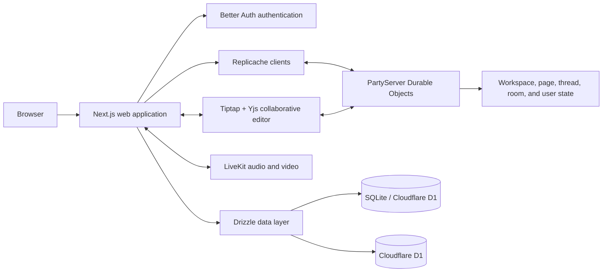

# Wodge

**A local-first collaborative workspace for team communication, knowledge management, and task coordination.**

Read the [repository documentation and feature index](docs/README.md) for the revival specifications, architecture, engineering guidance, and migration review status. The implementation and walkthrough below describe the capstone baseline; the revival targets are not claimed complete.

[](https://nextjs.org/)
[](https://www.typescriptlang.org/)
[](https://replicache.dev/)
[](https://www.partykit.io/)
[](https://better-auth.com/)
[](LICENSE)

> Watch the [project walkthrough](https://youtu.be/vNmMOMotGfY) for a complete product tour.

## Overview

Wodge is a collaborative workspace that brings structured team communication, real-time rooms, shared knowledge, and task management into one product. It was built as a five-member engineering capstone and received an **A+ evaluation**.

The project explores a local-first architecture in which users can interact with workspace data through responsive local state while synchronization is coordinated through Replicache and PartyServer Durable Objects. Collaborative documents use Yjs/CRDT-based editing, and live audio/video rooms are powered by LiveKit.

## Highlights

- **Local-first synchronization** using Replicache with separate synchronized models for workspaces, pages, threads, rooms, and users.
- **Real-time collaboration** through PartyServer Durable Objects and presence-aware workspace flows.
- **Collaborative documents** built with Tiptap and Yjs/CRDTs.
- **Team communication** through channels, threaded posts, comments, chat, polls, and audio/video rooms.
- **Embedded task management** with assignees, priorities, table views, and Kanban-style organization.
- **Workspace administration** including teams, groups, invitations, membership roles, and permission-aware interfaces.
- **Monorepo architecture** using Turborepo, pnpm workspaces, shared TypeScript configuration, and shared data models.

## Product Capabilities

### Workspaces and access

- Create and join workspaces through invitation flows.
- Organize members into teams and groups.
- Manage workspace, team, and group settings.
- Apply owner, administrator, moderator, and member-aware behavior.
- Track workspace presence and recently visited resources.

### Communication

- Create channels for threaded discussions and live rooms.
- Publish posts, comments, and Q&A-style content.
- Send, edit, and delete real-time room messages.
- Run polls inside collaborative flows.
- Join LiveKit-powered audio/video conferences with device and track controls.

### Knowledge and task management

- Create hierarchical workspace pages.
- Edit rich collaborative documents with Tiptap and Yjs.
- Add structured tasks directly inside documents.
- Manage task priorities, assignees, columns, table layouts, and Kanban views.
- Reorder tasks and columns through synchronized mutations.

## Architecture



### Synchronization model

Wodge separates synchronized state by domain rather than treating the whole product as one global document. Workspace structure, threads, pages, rooms, and user state each have their own models and mutation flows. Replicache handles local-first reads and mutations, while PartyServer coordinates real-time synchronization and presence. Yjs is used specifically for collaborative rich-text editing.

## Technology

| Area                    | Technologies                                        |
| ----------------------- | --------------------------------------------------- |
| Web application         | Next.js, React, TypeScript, Tailwind CSS, Radix UI  |
| Local-first data        | Replicache, shared mutation models, Zod validation  |
| Real-time backend       | PartyServer, WebSockets, presence-aware services    |
| Collaborative editing   | Tiptap, Yjs, y-partykit                             |
| Audio and video         | LiveKit                                             |
| Data layer              | Drizzle ORM, SQLite/Cloudflare D1                   |
| Authentication          | Better Auth                                         |
| State and data fetching | TanStack Query, Zustand, Jotai, Immer               |
| Tooling                 | Turborepo, pnpm, Vitest, ESLint, Prettier, Wrangler |
| Deployment              | Cloudflare Workers/Durable Objects, GitHub Actions  |

## Repository Structure

```text
.
├── apps/
│   ├── web/          # Next.js application, UI, routes, editor, and API handlers
│   └── backend/      # PartyServer Durable Objects for workspace, room, thread, page, and user sync
├── packages/
│   ├── data/         # Shared schemas, models, mutations, keys, and database utilities
│   ├── env/          # Shared environment configuration
│   └── ts/           # Shared TypeScript configuration
├── config/           # Shared development configuration
└── .github/          # GitHub Actions workflows
```

## Getting Started

### Prerequisites

- Node.js 22.19 or newer (`.node-version` selects 24.19.0)
- pnpm 12 (`packageManager` pins 12.15.0)
- A Linux-based development environment is recommended
- LiveKit Server for local audio/video development
- Accounts or local substitutes for the external services configured in `.env.example`

### Installation

```bash
git clone https://github.com/AMR-21/Wodge.git
cd Wodge
pnpm install
```

Create the public web configuration:

```bash
cp .env.example apps/web/.env.local
```

Backend secrets come from Bitwarden Secrets Manager rather than a `.dev.vars`
file. Create a Bitwarden project for the application containing the keys listed
in `apps/backend/.dev.vars.example`, plus a read-only machine account with access
to that project only. Then, once per machine:

```bash
pnpm secrets setup   # prompts for the project ID and access token, then downloads
pnpm secrets list    # shows the stored secret names
```

The script stores the token and the downloaded secrets in the operating system
credential store (macOS Keychain, Windows Credential Manager for WSL and Git
Bash, or a Linux Secret Service keyring). All clones and worktrees share those
entries. Commands read secrets from that store only, so they start offline. See
[local secrets](#local-secrets).

Backend owns the D1 binding in `apps/backend/wrangler.jsonc`. Web has public
configuration only; backend secrets are injected by `pnpm secrets run`. Better
Auth supports Google and GitHub sign-in; email sign-in is disabled. The web dev server forwards API calls
to the backend Worker. See [backend setup](apps/backend/README.md).

Production uses manually triggered Wrangler deployment. Namespace/data cutover,
provider credentials and web-origin routing must be configured before deployment.

Initialize the local application state and database:

```bash
pnpm init:app
```

Start LiveKit in a separate terminal when testing calls:

```bash
pnpm livekit
```

Start the monorepo with backend secrets injected:

```bash
pnpm secrets run -- pnpm dev
```

You can also run an individual workspace through Turborepo filtering:

```bash
pnpm dev --filter web
pnpm secrets run -- pnpm dev --filter backend
```

### Local secrets

`scripts/secrets.sh` is self-contained and application-neutral:

| Command                         | Purpose                                                        |
| ------------------------------- | -------------------------------------------------------------- |
| `pnpm secrets setup`            | Store or replace the project ID and token, then refresh        |
| `pnpm secrets refresh`          | Download the current secrets from Bitwarden into the store     |
| `pnpm secrets list`             | List stored secret names, never values                         |
| `pnpm secrets run -- <command>` | Run a command with the stored secrets as environment variables |
| `pnpm secrets forget`           | Delete the stored token and secrets                            |

Only `setup` and `refresh` contact Bitwarden; they install a checksum-pinned
`bws` CLI when it is missing. `run` needs neither `bws` nor network access. After
changing a secret in Bitwarden, run `pnpm secrets refresh` and restart the
command. Secrets are base64-encoded `KEY=VALUE` records inside the credential
store and are never written to files.

Entries are named `bws/<package.json name>/token` and `.../secrets`, with
numbered `#n` continuation entries for large values; set `BWS_APP` to choose
another name, `BWS_CREDENTIAL_STORE` (`macos`, `windows` or `secret-service`) to
override detection, `BWS_INSTALL_DIR` to change where `bws` is installed
(default `~/.local/bin`), and `BWS_SERVER_URL` for EU or self-hosted Bitwarden.

`run` sets `CLOUDFLARE_INCLUDE_PROCESS_ENV=true` so Wrangler reads the secrets
from the environment, and refuses to start while a `.dev.vars` file exists
because Wrangler would silently prefer it. Wrangler then exposes the whole local
process environment to the Worker in local development only; deployments are
unaffected. The access token is removed from the launched process environment.

Machine-account access tokens are valid until they expire or are revoked. An
expired token only affects `refresh`, which stops with an explanation: create a
new token for the machine account, then run `pnpm secrets setup`. Failed
refreshes, including network or server errors, leave the stored secrets
unchanged, so `run` keeps working.

## Useful Commands

```bash
pnpm dev             # Start development services
pnpm secrets         # Manage local Bitwarden secrets
pnpm build           # Build all workspaces
pnpm lint            # Run linting across the monorepo
pnpm lint:fix        # Apply safe lint fixes
pnpm format          # Format the monorepo
pnpm format:check    # Check formatting without writing files
pnpm generate        # Generate database artifacts
pnpm migrate:local   # Apply local database migrations
pnpm studio          # Open the database studio
pnpm reset:app       # Reset local generated Wrangler state
```

## Project Status

The public repository contains the capstone version of Wodge and is suitable for architecture review and local exploration. The codebase includes deployment automation for Cloudflare Workers, but a complete turnkey self-hosting guide is still being consolidated.

Some integrations require third-party credentials, including Google/GitHub OAuth providers, LiveKit, Cloudflare, and other optional services represented in `.env.example`.

## Team and Contribution

Wodge was built by a five-member team. **Amr Yasser served as Scrum Master and contributed across the majority of the monorepo**, including frontend development, backend services, synchronization flows, collaborative editing, and deployment tooling.

## License

Wodge is licensed under the [GNU Affero General Public License v3.0](LICENSE).

## Contact

For questions about the project or self-hosting status, contact [Amr Yasser](mailto:amryasseremam@gmail.com).
