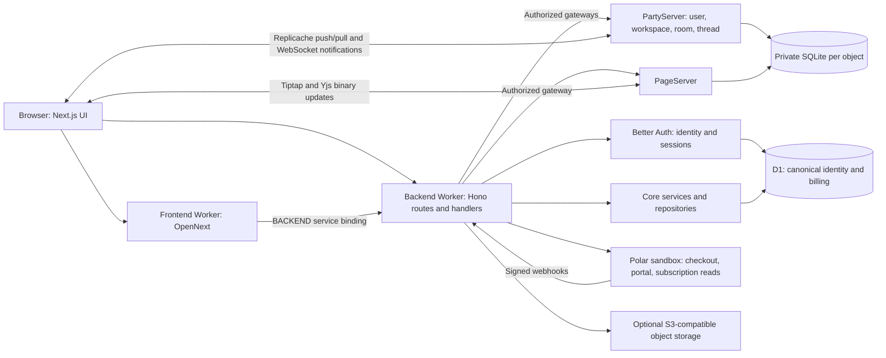

# Current application architecture

[Docs home](../README.md) · [Architecture](README.md)

This page describes the source revision in the [verification record](../development/documentation-verification.md). Deployment and browser acceptance have separate evidence boundaries.

## Request and dependency ownership

The public origin routes `/api/*`, `/parties/*` and `/health` to the backend Worker; the frontend Worker serves other paths. Server-side web requests use the `BACKEND` service binding; local Next.js development uses HTTP forwarding. The browser never queries D1 or imports backend services.

Backend flow is route → handler → core service → repository → persistence. Handlers validate and authorize requests and coordinate gateways/providers. Core services enforce business invariants and persist through repositories. Domain owns declarative contracts; infrastructure owns technical clients and database primitives. TSyringe composition is centralized at backend runtime initialization, with one dependency graph per Worker environment or object activation. Request identity is passed as operation input.

D1 is canonical for users, organizations, memberships, invitations and billing. Workspace objects hold internal structure, resource policies and projections; other objects own their domain records. Authorization is enforced at HTTP and direct object/realtime entry points. Ingress verifies sessions/tickets and replaces untrusted identity headers. [Security](security.md) describes the permission boundaries.

## Synchronization and durability

Replicache owns browser-local structured reads, optimistic mutations and push/pull synchronization. User, workspace, room, thread and page records synchronize separately. Server SQLite stores relational entities, revisions and client acknowledgements. Reconnect/retry preserves the existing protocol; optimistic display does not prove server acceptance.

Yjs handles rich text independently of Replicache tasks. PageServer durably appends binary updates to SQLite before completing message handling; snapshots and journals restore the current document after restart. Compaction does not preserve document version history. Table/Kanban editor nodes reference the page's task collection rather than owning copies.

Each object's awaited startup applies its Drizzle migrations and one-time legacy imports. This works inside SQLite-backed namespaces; it does not copy an old PartyKit deployment or convert another namespace's storage. Local SQLite transactions do not make cross-object calls, D1 writes and final sync acknowledgements one rollback transaction. See [persistence and recovery constraints](data-model.md).

## Integrations and unavailable capabilities

Better Auth offers Google/GitHub OAuth. Polar integration always selects the sandbox; verified subscription state controls entitlement, never checkout redirects. Optional object storage handles uploads and avatars when configured and enabled. Missing optional providers return unavailable errors rather than fabricated success.

Calls remain permanently disabled in this revision despite retained LiveKit code/dependencies. Hosted generation endpoints and SDKs have been removed. Resource libraries and MCP are unavailable. MCP discovery/read/task designs describe deferred milestone 2 work, with no supported client or executable tool registry today. Feature flags cannot enable an unavailable implementation. See [flag enforcement](../operations/runbooks/feature-flags.md).

The web still uses Next.js; a future TanStack frontend migration owns its documentation refresh. No frontend migration, new provider deployment or data cutover is implied by this documentation change.
